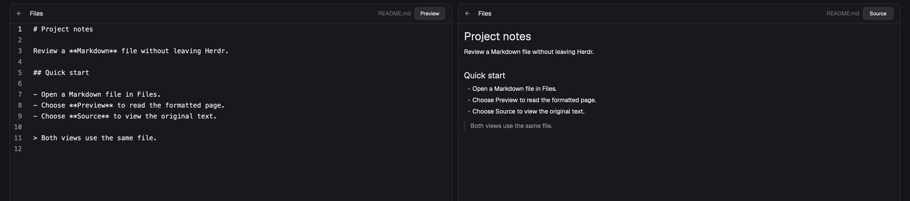

# Files Markdown

Browse files in Herdr App and read Markdown without leaving the Files panel. Switch between rendered Markdown and read-only source in the same space.

## What you see

A theme-colored Files card with a 42 px header. An open file shows a back arrow, its path, and, for a readable `.md` file, a compact **Preview** or **Source** button at the far right. The body shows either a read-only editor or padded, selectable, scrollable Markdown. The screenshot places two copies side by side to show both states.

## How it behaves

Folders expand on click and load on demand. Opening a file starts in Source; clicking **Preview** renders the already loaded text in place. **Source** returns to the editor. The back arrow returns to the file tree. Non-Markdown, missing, and unreadable files have no toggle. A newer file selection supersedes pending reads.

## Built from

Copy the bundled `mods/files-markdown/` into the Herdr App home. Duplicate a shipped layout before editing it, then change the Files block's `content.mod` from `files` to `files-markdown`. No keys or layout are bundled. The mod uses `EditorState`/`Editor` and `TextView.markdown` from `gpui-base`. Based on the Files mod shipped with [Herdr App](https://github.com/herdrdev/herdr-app) 0.1.16; upstream code and assets are Apache-2.0 licensed. This copy adds the Markdown view, toggle, and stale-read guard.

## Watch out

The mod reads files under the focused terminal's directory, on its machine, and runs `sh` or PowerShell to list files and `git` to show working-tree marks. It does not edit files. The display uses at most 400,000 UTF-16 code units plus a truncation notice. Markdown uses native rendering and link handling, not a browser view.

## Done when

1. `herdr-app check ~/.config/herdr-app/mods/files-markdown` passes.
2. Open a `.md`: source appears first. Preview renders a heading and list in the same panel; Source restores the editor.
3. Open a non-Markdown file: the editor stays available and the toggle is absent.
